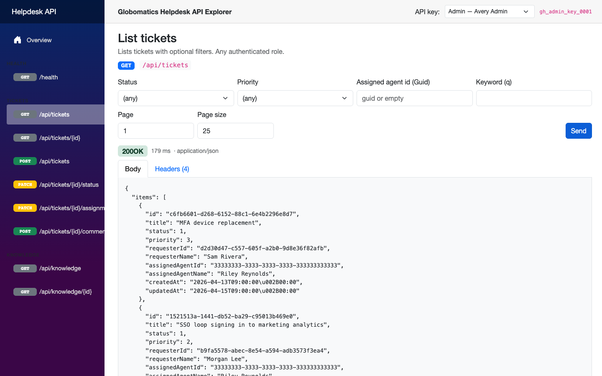

# Module 1 · Starting point — Globomatics Helpdesk (no AI yet)

Branch: **`module-1/demo/1-start`** · Course: **Building AI-Augmented ASP.NET Core 10 Web APIs**

This is the clean starting point the course builds on: a conventional ASP.NET Core 10 minimal API for an
internal IT helpdesk — tickets, comments, agents, users, and a knowledge base — with API-key auth,
FluentValidation, OpenAPI docs, and an in-memory database, fronted by a small Blazor API explorer and run
with .NET Aspire. **There is intentionally no AI here.** Every later branch layers AI on top of this base.

> **New to the repo?** See the [`main`](https://github.com/codemillmatt/ai-augmented-dotnet-web-apis/tree/main) branch for the course overview and full setup.

## What Module 1 teaches

> *"We're taking a regular ASP.NET Core Web API and wiring in some AI features to make it a lot more
> capable — using minimal API patterns you already know."*

Module 1 makes the case that adding an LLM doesn't require re-architecting your app. Routing, DI,
configuration, and auth all stay the same. What's new is a handful of realities you'll design around:

- responses are **natural language**, not fixed JSON,
- the model adds **latency** (seconds, not milliseconds), which motivates **streaming**,
- you pay per **token**, and outputs are **non-deterministic**.

The rest of the module wires up a chat endpoint (`module-1/demo/2-wire-up`) and then streams it token by
token (`module-1/demo/3-stream`). This branch is where you start — before any of that exists.

## What's in this branch

Everything the AI features will hang off of, and nothing more:

| Area | What it is |
| ---- | ---------- |
| `Endpoints/TicketsEndpoints.cs` | Ticket CRUD + status/assignment/comments, grouped under `/api/tickets` |
| `Endpoints/KnowledgeEndpoints.cs` | Read-only knowledge base under `/api/knowledge` |
| `Auth/` | `X-Api-Key` authentication handler, key store, and role policies |
| `Validation/` | FluentValidation validators wired in via an endpoint filter |
| `Data/` | EF Core in-memory `DbContext` + deterministic `DataSeeder` |
| `GlobomaticsHelpdesk.Web` | Blazor **API explorer** — one page per endpoint, with an API-key picker |
| `GlobomaticsHelpdesk.AppHost` | Aspire orchestrator that runs the API + web together |

## What it looks like



*The Blazor API explorer on `module-1/demo/1-start`: pick a role, call any endpoint, and inspect status, timing, headers, and JSON. No AI yet — this is the base every later module builds on.*

## Run it

No AI keys or model deployments are needed for this branch — just run:

```bash
aspire run
```

Open the dashboard URL printed in the console, then open **web** (the Blazor API explorer) and **api**.
The API listens on `http://localhost:5119`; the OpenAPI document is at `/openapi/v1.json`.

## Try it

Every `/api/*` route needs an API key in the `X-Api-Key` header. Three roles are seeded:

| Role | API key | Identity |
| ---- | ------- | -------- |
| `admin` | `gh_admin_key_0001` | Avery Admin |
| `agent` | `gh_agent_key_0001` | Riley Reynolds |
| `read-only` | `gh_readonly_key_0001` | Quinn Viewer |

In the Blazor explorer, pick a role from the top bar and exercise any endpoint — the response panel shows
status code, elapsed time, headers, and pretty-printed JSON. A request without a valid key comes back
`401`; the key picker sets the `X-Api-Key` header for you. Note ticket **1001** ("Cannot connect to VPN
from home") — the demos reference it throughout the course.

## Previous
_None — this is the first branch in the course._

## Next
[`module-1/demo/2-wire-up`](https://github.com/codemillmatt/ai-augmented-dotnet-web-apis/tree/module-1/demo/2-wire-up) — wire up a chat endpoint with `IChatClient`.
