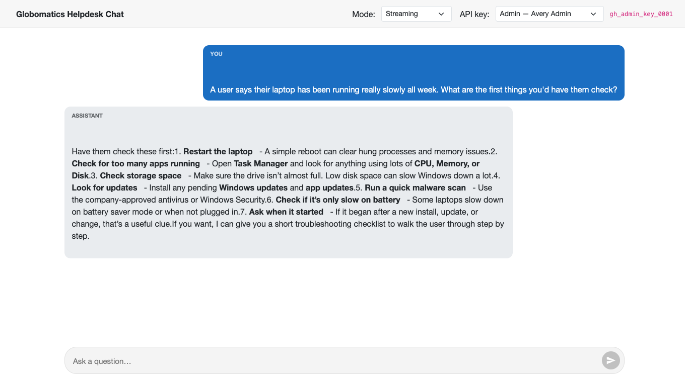

# Module 1 · Demo — Stream the chat response

Branch: **`module-1/demo/3-stream`** · Course: **Building AI-Augmented ASP.NET Core 10 Web APIs**

This demo turns the non-streaming chat endpoint into a **streaming** one that pushes tokens to the browser
as the model generates them, over Server-Sent Events (SSE). Same model, same work — dramatically better
experience.

> See [`main`](https://github.com/codemillmatt/ai-augmented-dotnet-web-apis/tree/main) for the course overview. Previous branch: `module-1/demo/2-wire-up`.

## What Module 1 teaches (streaming)

> *"Streaming does not make the model faster. It makes the user experience better."*

The model still takes the same total time; streaming just delivers the first token in a few hundred
milliseconds instead of making the user wait for the whole response. This branch shows that switching to
streaming is a **response-delivery change only** — the DI registration, config, auth, and validation are
untouched. Both `GetResponseAsync` (full) and `GetStreamingResponseAsync` (streaming) live on the *same*
`IChatClient`.

## What this demo adds

| Piece | File | Why it matters |
| ----- | ---- | -------------- |
| Streaming endpoint | `Endpoints/ChatEndpoints.cs` | New `POST /api/chat/stream` returning `ServerSentEventsResult<string>` via `TypedResults.ServerSentEvents(...)` |
| Token pump | `Endpoints/ChatEndpoints.cs` | `StreamTextDeltas(...)` — an `async IAsyncEnumerable<string>` over `GetStreamingResponseAsync`, yielding each chunk's `.Text` |
| Client streaming | `Web/wwwroot/js/streaming.js`, `Services/HelpdeskApiClient.cs`, `Components/Shared/ChatModePicker.razor`, `Services/ChatModeState.cs` | The Blazor UI consumes the SSE stream and lets you toggle streaming vs. full response side by side |

Two details worth calling out in `ChatEndpoints.cs`:

- **`TypedResults.ServerSentEvents(...)`** sets `Content-Type: text/event-stream`, keeps the connection
  open, and writes each yielded value as a `data:` event — you write none of that plumbing yourself.
- **`[EnumeratorCancellation]`** on the `CancellationToken` wires client disconnects to the model call:
  close the tab mid-stream and the request is cancelled, so you stop burning tokens on a reply nobody's
  reading.

**`Program.cs` doesn't change** — the streaming endpoint uses the exact same `AddChatClient(...)`
registration as the non-streaming one.

## What it looks like



*Same chat, now with a **Mode** switch. In *Streaming* mode the answer renders token by token over SSE instead of appearing all at once.*

## Setup

Same as the previous branch — an Azure AI Foundry **chat** deployment and the `ChatProvider:ApiKey` user
secret on `src/GlobomaticsHelpdesk.Api`:

```bash
cd src/GlobomaticsHelpdesk.Api
dotnet user-secrets set "ChatProvider:ApiKey" "<your-foundry-api-key>"
```

## Run it

```bash
aspire run
```

Open **web** from the Aspire dashboard.

## Try it

Send the same prompt to both endpoints and compare:

```http
### Full response (dead air, then everything at once)
POST http://localhost:5119/api/chat
X-Api-Key: gh_agent_key_0001
Content-Type: application/json

{ "prompt": "My VPN keeps timing out after MFA approval. What should I check first?" }

### Streamed response (first tokens almost immediately)
POST http://localhost:5119/api/chat/stream
X-Api-Key: gh_agent_key_0001
Content-Type: application/json

{ "prompt": "My VPN keeps timing out after MFA approval. What should I check first?" }
```

In the web UI, use the mode picker to switch between full and streaming. The total time is about the same;
the experience is completely different.

## Previous
[`module-1/demo/2-wire-up`](https://github.com/codemillmatt/ai-augmented-dotnet-web-apis/tree/module-1/demo/2-wire-up) — the full (non-streaming) chat endpoint.

## Next
[`module-2/demo/1-build-knowledge-base`](https://github.com/codemillmatt/ai-augmented-dotnet-web-apis/tree/module-2/demo/1-build-knowledge-base) — **Module 2** grounds the model in your data with RAG.
