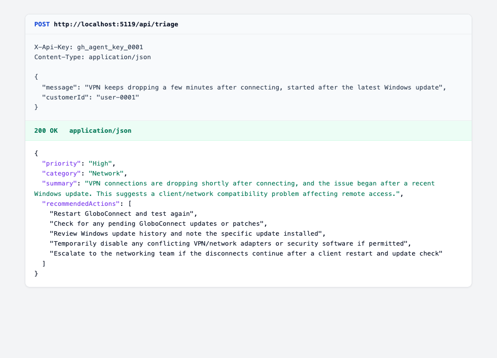

# Module 6 · Demo — Build an agentic triage endpoint

Branch: **`module-6/demo/1-triage-endpoint`** · Course: **Building AI-Augmented ASP.NET Core 10 Web APIs**

The capstone. This demo builds an **agentic** endpoint: you hand the model a raw support request and a set
of tools, and it runs its *own* investigation — deciding what to look up and when — then returns a
**structured triage decision** as typed JSON, all in a single HTTP call.

> See [`main`](https://github.com/codemillmatt/ai-augmented-dotnet-web-apis/tree/main) for the course overview. Previous branch: `module-5/demo/2-adding-telemetry`.

## What Module 6 teaches

> *"It's the same tool-calling loop sitting under both endpoints. But for the agentic endpoint we take the
> human out and point the model at a goal."*

The shift from the chat endpoint to the triage endpoint:

| | Chat endpoint | Triage endpoint |
| --- | --- | --- |
| **Retrieval** | Your code searches, then calls the model | The model decides to call the search tool itself |
| **Control** | A person steers each turn | Given a goal, it runs on its own |
| **Output** | Streams free text | Returns a **typed record** (structured JSON) |

This is composition, not new infrastructure — the triage endpoint reuses the exact same hardened,
observable `IChatClient` pipeline from Modules 3–5.

## What this demo adds

| Piece | File | Why it matters |
| ----- | ---- | -------------- |
| Result + request | `Contracts/TriageDtos.cs` | `TriageResult(Priority, Category, Summary, RecommendedActions)` and `TriageRequest(Message, CustomerId?)` |
| The endpoint | `Endpoints/TriageEndpoints.cs` | `POST /api/triage` calls `chatClient.GetResponseAsync<TriageResult>(...)`, which derives a JSON schema from the record and asks the model to fill it |
| Triage tools | `Endpoints/TriageEndpoints.cs` → `GetTriageTools(...)` | Three read-only tools (search KB, get ticket, list by status); the system prompt says *"use at least one tool to gather context before you decide — you pick which, in what order"* |
| Validation | `Validation/Validators/TriageRequestValidator.cs` | Validates the incoming request |
| Registration | `Program.cs` | `app.MapTriageEndpoints()` — no new packages; everything triage needs already exists |

The `GetResponseAsync<TriageResult>()` call is the key: instead of streaming tokens, the endpoint waits for
the complete object and hands it back in one piece — something a downstream system can act on directly.

## What it looks like



*`POST /api/triage` returns a complete structured decision — priority, category, summary, and recommended actions — as JSON, not a token stream.*

## Setup

Chat + embedding Foundry deployments and the `ChatProvider:ApiKey` user secret on
`src/GlobomaticsHelpdesk.Api`:

```bash
cd src/GlobomaticsHelpdesk.Api
dotnet user-secrets set "ChatProvider:ApiKey" "<your-foundry-api-key>"
```

## Run it

```bash
aspire run
```

The triage endpoint returns JSON, not a token stream, so test it with `requests.http` (or curl) rather than
the chat UI.

## Try it

```http
POST http://localhost:5119/api/triage
X-Api-Key: gh_agent_key_0001
Content-Type: application/json

{ "message": "VPN keeps dropping after Windows update", "customerId": "user-0001" }
```

You'll get back a fully populated record, e.g.:

```json
{
  "priority": "High",
  "category": "network",
  "summary": "VPN connection dropping after Windows update; related to GloboConnect configuration...",
  "recommendedActions": ["Check GloboConnect SSO settings", "Verify MFA prompt", "Review KB article: k-vpn"]
}
```

You never told it to search the knowledge base — you gave it the tools and a goal, and it decided to. The
summary references real KB content, proof it called the search tool. *"The model didn't just use a tool
loop. It owned one, start to finish."*

## Previous
[`module-5/demo/2-adding-telemetry`](https://github.com/codemillmatt/ai-augmented-dotnet-web-apis/tree/module-5/demo/2-adding-telemetry) — a safe, auditable endpoint.

## Next
[`module-6/demo/2-testing-pipeline`](https://github.com/codemillmatt/ai-augmented-dotnet-web-apis/tree/module-6/demo/2-testing-pipeline) — add production guardrails and audit the whole run in the dashboard.
