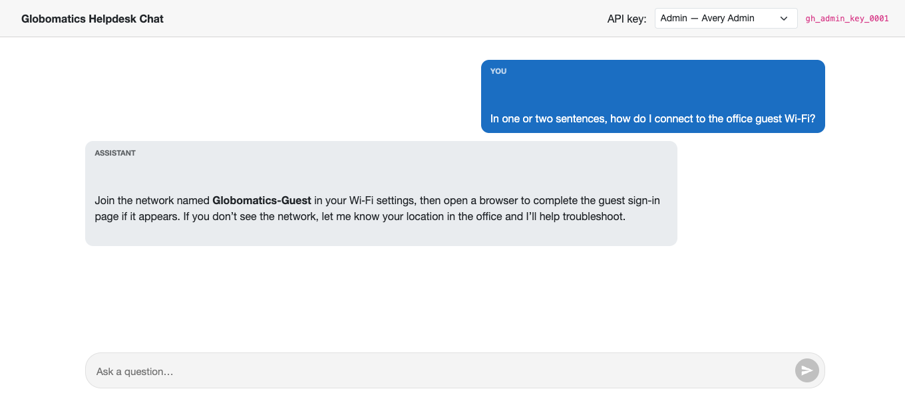

# Module 1 · Demo — Wire up a chat endpoint

Branch: **`module-1/demo/2-wire-up`** · Course: **Building AI-Augmented ASP.NET Core 10 Web APIs**

This demo adds the course's first piece of AI: a chat endpoint that sends a prompt to a model and returns
the full reply. It's the non-streaming baseline — deliberately simple, so the *latency* problem it exposes
motivates the streaming demo that follows.

> See [`main`](https://github.com/codemillmatt/ai-augmented-dotnet-web-apis/tree/main) for the course overview. Previous branch: `module-1/demo/1-start`.

## What Module 1 teaches

Module 1 shows that adding an LLM to an existing Web API is a layer on top of familiar patterns, not a
rewrite. The key idea introduced here is the **provider abstraction**: instead of coupling to one vendor's
SDK, you program against **`Microsoft.Extensions.AI`**'s `IChatClient`. Swap the model or provider at
*config time*, and none of your endpoint code changes.

## What this demo adds

| Piece | File | Why it matters |
| ----- | ---- | -------------- |
| Chat DTOs | `Contracts/ChatDtos.cs` | `ChatRequest` (prompt) and `ChatReplyDto` (reply) records |
| Validation | `Validation/Validators/ChatRequestValidator.cs` | Prompt required, max length — same pattern as the ticket validators |
| The endpoint | `Endpoints/ChatEndpoints.cs` | `POST /api/chat` → builds a system + user message and calls `chatClient.GetResponseAsync(...)` |
| DI wiring | `Program.cs` | `AddChatClient(...)` registers `IChatClient`, wrapping an OpenAI-compatible `ChatClient` via `.AsIChatClient()` |
| Config | `appsettings.json` | `ChatProvider:Endpoint` + `ChatProvider:Model` (the API key lives in user secrets) |
| Chat UI | `GlobomaticsHelpdesk.Web` | The API explorer is replaced with a simple chat page |

The line to notice in `Program.cs` is `.AsIChatClient()` — **the provider boundary**. Everything
downstream injects `IChatClient` and has no idea which provider is behind it.

## What it looks like



*The new `/api/chat` endpoint answering a question — one LLM call behind the minimal-API patterns you already use. No streaming, no grounding, no tools yet; those arrive in the next demos.*

## Setup

You need an Azure AI Foundry **chat** deployment for this branch (no embedding model yet). Point the app at
your endpoint in `appsettings.json` (`ChatProvider:Endpoint` / `ChatProvider:Model`, default
`gpt-5.4-mini`), then store the key as a user secret on the API project:

```bash
cd src/GlobomaticsHelpdesk.Api
dotnet user-secrets set "ChatProvider:ApiKey" "<your-foundry-api-key>"
```

> Full setup details are on the [`main`](https://github.com/codemillmatt/ai-augmented-dotnet-web-apis/tree/main) branch. There's **no API key in
> `appsettings.json`** by design — user secrets keep it out of source control.

## Run it

```bash
aspire run
```

Open **web** from the Aspire dashboard and use the chat box, or call the API directly at
`http://localhost:5119`.

## Try it

```http
POST http://localhost:5119/api/chat
X-Api-Key: gh_agent_key_0001
Content-Type: application/json

{ "prompt": "My VPN keeps timing out after MFA approval. What should I check first?" }
```

Watch what happens: the screen sits for **several seconds of dead air**, then the whole answer drops in at
once. That pause is the point — LLM responses love to run long, and waiting for the entire thing is a poor
experience. The next branch fixes it. (Also note the answer is generic IT advice; it doesn't know anything
Globomatics-specific yet — that's Module 2.)

## Previous
[`module-1/demo/1-start`](https://github.com/codemillmatt/ai-augmented-dotnet-web-apis/tree/module-1/demo/1-start) — the starter app, before any AI wiring.

## Next
[`module-1/demo/3-stream`](https://github.com/codemillmatt/ai-augmented-dotnet-web-apis/tree/module-1/demo/3-stream) — stream that same response back token by token.
