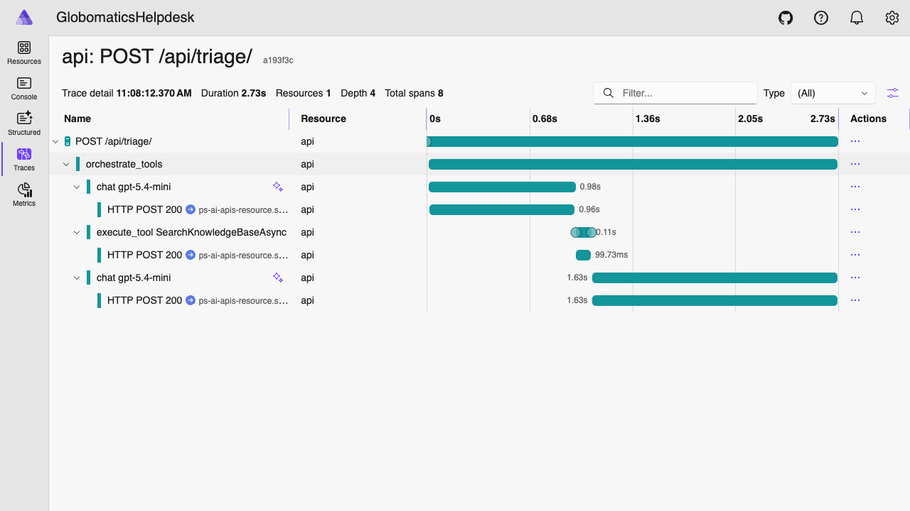

# Module 6 · Demo — Test and bound the agentic pipeline

Branch: **`module-6/demo/2-testing-pipeline`** · Course: **Building AI-Augmented ASP.NET Core 10 Web APIs**

The final demo (and the finished reference app). It takes the working triage endpoint and makes it
**production-worthy**: bounded tool-calling iterations, reduced output variance, and a full audit trail —
then runs the pipeline end-to-end and reads the reasoning chain in the Aspire dashboard.

> See [`main`](https://github.com/codemillmatt/ai-augmented-dotnet-web-apis/tree/main) for the course overview. Previous branch: `module-6/demo/1-triage-endpoint`.

## What Module 6 teaches (trust)

An agentic endpoint feeds a real workflow — it might trigger an escalation or route a ticket — so *"when
something goes sideways down the line, you need to know what the model actually did and why."* Trust comes
from three additions:

- **Bounded loops** — cap how many times the agent can round-trip to the model.
- **Reduced variance** — nudge repeated runs toward the same decision.
- **Auditability** — the telemetry from Module 5 makes every step visible after the fact.

## What this demo adds

| Piece | File | Why it matters |
| ----- | ---- | -------------- |
| Iteration cap | `Program.cs` | `.UseFunctionInvocation(configure: c => c.MaximumIterationsPerRequest = 8)` — the default is 40; 8 is a safety net *and* a cost control (it includes the initial call) |
| Variance controls | `Endpoints/TriageEndpoints.cs` | `ChatOptions { Temperature = 0.1f, Seed = 12345 }` — lower temperature is more focused/repeatable; the seed nudges runs toward the same result |
| Test scenarios | `requests.http` | Expanded triage requests for running the pipeline end-to-end |

> Temperature and seed **reduce** variance; they don't guarantee determinism — models are non-deterministic
> and seed support is best-effort. The fields a workflow acts on (priority, category) stay stable; summary
> wording may vary slightly.

## What it looks like



*The whole agentic pipeline in one trace — `orchestrate_tools` → `chat` → `SearchKnowledgeBaseAsync` → `chat`, eight spans deep — exactly the flow the tests in this demo bound and assert.*

## Setup

Chat + embedding Foundry deployments and the `ChatProvider:ApiKey` user secret on
`src/GlobomaticsHelpdesk.Api`:

```bash
cd src/GlobomaticsHelpdesk.Api
dotnet user-secrets set "ChatProvider:ApiKey" "<your-foundry-api-key>"
```

## Run it

```bash
aspire run
```

Run via the AppHost so traces export to the dashboard. Use `requests.http` to drive the endpoint and keep
the dashboard's **Traces** tab open.

## Try it

Send the same request **twice** and compare:

```http
POST http://localhost:5119/api/triage
X-Api-Key: gh_agent_key_0001
Content-Type: application/json

{ "message": "VPN keeps dropping after Windows update", "customerId": "user-0001" }
```

- **Priority** and **category** come back the same across both runs — that's temperature and seed doing
  their job. Summary wording may read slightly differently, which is fine.
- In **Traces**, open a run: the `POST /api/triage` HTTP span, a grouping span for the tool loop, and one
  `chat` span per round-trip (each with token counts). Read the spans top-to-bottom to watch the model
  decide to search, get the article back, and land on its decision — capped at 8 iterations.

*"That's the whole point — an agentic endpoint you can reason about, put bounds on, and audit after the
fact."*

## The whole course, in one endpoint

This capstone composes everything:

- **RAG** (Module 2) — the model's knowledge-base search tool,
- **Tools** (Module 3) — built the same way as the chat tools,
- **MCP** (Module 4) — the same tool layer, reusable by external agents,
- **Hardening** (Module 5) — input validation and output filtering still run in the pipeline,
- **Telemetry** (Module 5) — makes the agent's reasoning auditable,
- **Agentic autonomy** (Module 6) — the model drives the investigation itself.

> *"Every one of those pieces leans on the same small handful of abstractions — the same chat client
> interface, the same middleware pipeline, the same dependency injection you're already using. And that's
> what 'AI-augmented' actually means: AI capabilities built right into the API you already know how to
> build, not some separate AI application bolted on the side."*

## Previous
[`module-6/demo/1-triage-endpoint`](https://github.com/codemillmatt/ai-augmented-dotnet-web-apis/tree/module-6/demo/1-triage-endpoint) — the initial triage endpoint.

## Next
_None — this is the end of the course._ This is the finished app that the [`main`](https://github.com/codemillmatt/ai-augmented-dotnet-web-apis/tree/main) branch mirrors.
