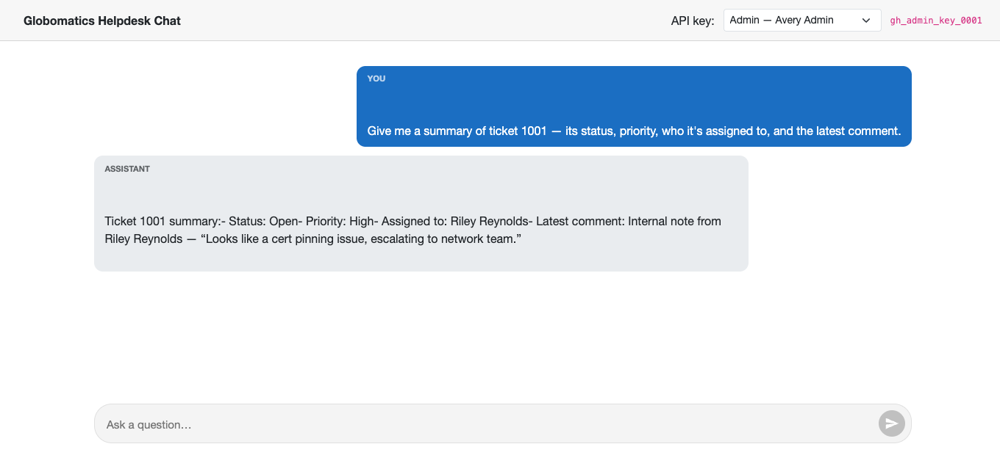

# Module 3 · Demo — Expose more tools, with guardrails

Branch: **`module-3/demo/2-exposing-tools`** · Course: **Building AI-Augmented ASP.NET Core 10 Web APIs**

This demo expands from one read-only tool to a small toolbox — including a **write** operation — and adds
the safety boundaries every AI tool needs: input validation and authorization. It also shows the model
**chaining** multiple tools to satisfy one request.

> See [`main`](https://github.com/codemillmatt/ai-augmented-dotnet-web-apis/tree/main) for the course overview. Previous branch: `module-3/demo/1-creating-tools`.

## What Module 3 teaches (safety)

> *"Each tool checks its own arguments the same way a regular API endpoint would. The model's just another
> caller. It gets the same rules as everyone else."*

Because *"models are confident even when they're dead wrong,"* every tool defends itself with three gates:

- **Input validation** — check types, ranges, and existence (the model may pass garbage).
- **Authorization** — tools run as the current user; write operations verify the caller's role.
- **Scope** — only expose the functions the model actually needs.

Rejected calls return a **descriptive error string** (not an exception), so the model can read the failure
and relay it to the user.

## What this demo adds

| Piece | File | Why it matters |
| ----- | ---- | -------------- |
| Read tool w/ validation | `Services/HelpdeskTools.cs` → `GetTicketsByStatusAsync(...)` | Filters by a `TicketStatus` enum; validates with `Enum.IsDefined(...)` and returns valid values on a bad input |
| Write tool w/ authz | `Services/HelpdeskTools.cs` → `UpdateTicketPriorityAsync(...)` | Validates priority + ticket existence, then checks `IsAgent()`/`IsAdmin()` via `ClaimsPrincipalAccessor` before updating |
| Multi-tool wiring | `Endpoints/ChatEndpoints.cs` → `GetTools(...)` | Builds three `AIFunction`s (`GetTicket`, `GetTicketsByStatus`, `UpdateTicketPriority`) and passes them in `ChatOptions.Tools` |

The model chooses which tools to call, and in what order — descriptions do the real work of tool
selection.

## What it looks like



*The model reaching into live helpdesk data through a tool — the pattern this demo extends with more tools and per-role guardrails.*

## Setup

Chat + embedding Foundry deployments and the `ChatProvider:ApiKey` user secret on
`src/GlobomaticsHelpdesk.Api`:

```bash
cd src/GlobomaticsHelpdesk.Api
dotnet user-secrets set "ChatProvider:ApiKey" "<your-foundry-api-key>"
```

## Run it

```bash
aspire run
```

Open **web** from the Aspire dashboard; use the API-key picker in the top bar to switch roles.

## Try it

```http
### Multi-tool chain (as an agent) — two pauses: list, then update
POST http://localhost:5119/api/chat/stream
X-Api-Key: gh_agent_key_0001
Content-Type: application/json

{ "prompt": "Show me all open tickets, then bump ticket 1001 to urgent." }

### Unauthorized write (as read-only) — tool returns "permission denied"
POST http://localhost:5119/api/chat/stream
X-Api-Key: gh_readonly_key_0001
Content-Type: application/json

{ "prompt": "Change ticket 1005 priority to low." }
```

- **Agent** request: two visible pauses — the model lists open tickets, then updates 1001's priority from
  High to Urgent and confirms.
- **Read-only** request: the write tool's authorization check fails and returns a "permission denied"
  string; the model relays it cleanly, no crash.
- Try an **invalid value** (`"...to priority 'extreme'"`) to watch validation reject it with the list of
  valid priorities.

## Previous
[`module-3/demo/1-creating-tools`](https://github.com/codemillmatt/ai-augmented-dotnet-web-apis/tree/module-3/demo/1-creating-tools) — the model's first (read-only) tool.

## Next
[`module-4/demo/1-create-mcp-server`](https://github.com/codemillmatt/ai-augmented-dotnet-web-apis/tree/module-4/demo/1-create-mcp-server) — **Module 4** exposes these same tools to external agent clients over MCP.
