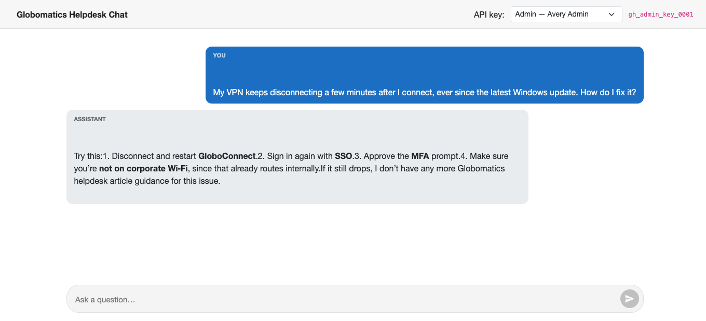

# Globomatics Helpdesk — AI-Augmented ASP.NET Core 10 Web APIs

Companion sample application for the Pluralsight course **Building AI-Augmented ASP.NET Core 10 Web APIs**.

Globomatics Helpdesk is an internal IT helpdesk: an ASP.NET Core 10 minimal API (tickets, comments,
agents, users, and a knowledge base) with API-key auth, FluentValidation, OpenAPI docs, and an in-memory
database — plus a small Blazor front end and a .NET Aspire AppHost that runs everything together.

The course starts from a conventional Web API with **no AI at all** and, module by module, layers AI
capabilities on top of it using the patterns you already know: minimal APIs, dependency injection, and
configuration. The point of the course is that "AI-augmented" means AI built *into* the API you already
know how to build — not a separate AI application bolted on the side.

> **How this repo is organized.** Each branch is a self-contained checkpoint for one demo in the course.
> Start on the branch you're interested in and read its README — every branch explains what its module
> teaches, the important pieces of that demo, and how to run it. This `main` branch is the finished
> reference; use it as the setup + run guide below.

## What it looks like



*The finished app: a chat endpoint that streams answers grounded in your knowledge base and can act on live tickets through tools.*

## Course map

| Module | Theme | Branches |
| ------ | ----- | -------- |
| **1 — LLM integration & real-time streaming** | Wire an `IChatClient` into a minimal API and stream tokens over SSE | `module-1/demo/1-start`, `module-1/demo/2-wire-up`, `module-1/demo/3-stream` |
| **2 — Grounding responses with RAG** | Embeddings, an in-memory vector store, and retrieval-augmented generation | `module-2/demo/1-build-knowledge-base`, `.../2-test-vector-search`, `.../3-integrating-rag` |
| **3 — Giving the model tools** | Function calling so the model can read and change live data safely | `module-3/demo/1-creating-tools`, `.../2-exposing-tools` |
| **4 — Model Context Protocol (MCP)** | Expose the same tools to any external agent client over MCP | `module-4/demo/1-create-mcp-server` |
| **5 — Hardening & observability** | Input validation, output filtering, and OpenTelemetry for AI calls | `module-5/demo/1-hardening-endpoints`, `.../2-adding-telemetry` |
| **6 — Agentic triage (capstone)** | An endpoint where the model investigates on its own and returns a structured decision | `module-6/demo/1-triage-endpoint`, `.../2-testing-pipeline` |

## Prerequisites

- **.NET 10 SDK** — the repo pins `10.0.201` via `global.json`.
- **.NET Aspire CLI** 13+ — the `aspire` command ([install](https://aka.ms/aspire/cli)).
- **An Azure AI Foundry project** with two model deployments (see below). Everything from Module 1
  onward calls a model, so you need this before the AI branches will run. `module-1/demo/1-start` needs no AI.
- macOS, Linux, or Windows.

## One-time setup: Azure AI Foundry

The app talks to models through an **OpenAI-compatible inference endpoint**, so it works against Azure AI
Foundry (the default in `appsettings.json`). You need two deployments in the **same** Foundry resource:

1. **A chat / inference model** — this is the built-in inference endpoint your Foundry resource already
   exposes. The config default is `gpt-5.4-mini`.
2. **An embedding model** — create an embedding deployment (used from Module 2 on for RAG). The config
   default is `text-embedding-3-small`.

### 1. Point the app at your Foundry endpoint

`src/GlobomaticsHelpdesk.Api/appsettings.json` already contains the shape you need — update the endpoint
(and, if different, the model/deployment names) to match your resource:

```jsonc
"ChatProvider": {
  "Endpoint": "https://<your-resource>.services.ai.azure.com/openai/v1",
  "Model": "gpt-5.4-mini"
},
"EmbeddingProvider": {
  "Endpoint": "https://<your-resource>.services.ai.azure.com/openai/v1",
  "Model": "text-embedding-3-small"
}
```

Use the `.../openai/v1` OpenAI-compatible path on your Foundry endpoint.

### 2. Store your API key as a user secret

The key is **never** kept in `appsettings.json`. Set it as a user secret on the API project. The
embedding client reuses the same key, so you only set one:

```bash
cd src/GlobomaticsHelpdesk.Api
dotnet user-secrets set "ChatProvider:ApiKey" "<your-foundry-api-key>"
```

## Run it

From the repo root, start everything with Aspire:

```bash
aspire run
```

Aspire builds and launches the **API**, the **Blazor web app**, and the **developer dashboard**. The
dashboard URL (with a one-time login token) is printed in the console. From it you can open:

- **web** — the Blazor front end (chat UI in the AI branches; an API explorer on `module-1/demo/1-start`).
- **api** — the helpdesk API. OpenAPI document at `http://localhost:5119/openapi/v1.json`.

The API listens on `http://localhost:5119` by default. A `/health` endpoint is exposed and needs no auth.

## Authentication

Every `/api/*` endpoint requires an API key in the `X-Api-Key` header. Three keys are seeded so the demos
just work; the Blazor UI has a picker to switch between them.

| Role        | API key                | Identity        | Can do |
| ----------- | ---------------------- | --------------- | ------ |
| `admin`     | `gh_admin_key_0001`    | Avery Admin     | Everything |
| `agent`     | `gh_agent_key_0001`    | Riley Reynolds  | Read + create/update/comment; reassign to self/unassigned |
| `read-only` | `gh_readonly_key_0001` | Quinn Viewer    | GET only |

A request without a valid key returns `401`; the Blazor UI's key picker sets the `X-Api-Key` header for
you, so you can switch roles without touching the request by hand.

## Seed data

A deterministic dataset loads into the in-memory database at startup: ~9 users, 4 agents, 25 tickets
(mixed statuses, priorities, assignments, and comments) and 10 knowledge base articles covering common IT
topics (VPN, MFA, password reset, printers, phishing, etc.). Ids are deterministic, so every run looks the
same — handy for the demos that reference specific tickets (e.g. ticket `1001`).

## Project structure

```
src/
├── GlobomaticsHelpdesk.Api/              # The minimal API
│   ├── Auth/                # API-key handler, store, policies
│   ├── Contracts/           # Request/response DTOs
│   ├── Data/                # DbContext + DataSeeder (in-memory DB)
│   ├── Domain/              # Entities + enums
│   ├── Endpoints/           # Endpoint extension methods (Tickets, Knowledge, ...)
│   ├── Validation/          # FluentValidation validators + endpoint filter
│   └── Program.cs
├── GlobomaticsHelpdesk.AppHost/          # Aspire AppHost (orchestrator)
├── GlobomaticsHelpdesk.ServiceDefaults/  # Aspire shared service defaults (incl. OpenTelemetry)
└── GlobomaticsHelpdesk.Web/              # Blazor front end
```

> On the AI branches, additional folders appear here — `Services/` (tools), `Middleware/` (safety),
> and `McpServer/` — as each module introduces them.

## Where to go next

Check out the branch for the module you want to explore and follow its README. A good linear path is:
`module-1/demo/1-start` → `module-1/demo/2-wire-up` → `module-1/demo/3-stream` → `module-2/...` → ... →
`module-6/demo/2-testing-pipeline`.
